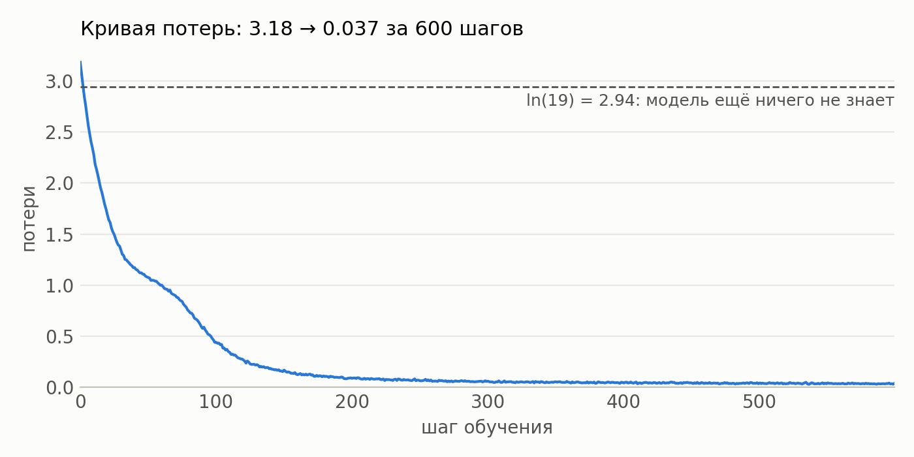

# Отчёт по ДЗ 1 «Внимание своими руками»

Вариант: seed 42, три подсаженные ошибки.

| Часть | Результат |
|---|---|
| `dz1-attention.ipynb`, четыре функции | 17 проверок из 17 |
| `dz1-bughunt.ipynb`, исходный код | 7 проверок из 17 |
| `dz1-bughunt.ipynb`, после исправлений | 17 проверок из 17 |
| Обучение исправленной модели | потери 3,184 → 0,037 за 600 шагов |

## 1. Реализация функций

| Функция | Решение |
|---|---|
| `split_heads` | Сначала `view` в `(B, L, H, d_head)`, затем `transpose(1, 2)`. Обратный порядок даёт ту же форму, но перемешивает каналы между головами. |
| `merge_heads` | `transpose(1, 2)`, затем `contiguous()` и `view`: после перестановки осей тензор не непрерывен в памяти. |
| `scaled_dot_product_attention` | Логиты делятся на `sqrt(d_k)`, маска подставляет `-inf` до softmax, softmax берётся по оси ключей, dropout применяется к весам. |
| `TransformerBlock.forward` | Схема pre-norm: `x + attn(norm1(x))`, затем `x + ffn(norm2(x))`. Возвращает `(x, веса внимания)`. |

## 2. Найденные ошибки

Строки указаны внутри ячейки «Код с подсаженными ошибками». Исправления не сдвигают нумерацию.

| # | Локализация | Механизм нарушения | Исправление |
|---|---|---|---|
| 1 | `sinusoidal_positional_encoding`, строка 39: `torch.arange(1, length + 1, ...)` | Отсчёт позиций начинается с 1, поэтому позиция `p` получает код позиции `p + 1`: таблица в точности равна верной, сдвинутой на одну строку. Первая строка вместо `[0, 1, 0, 1, ...]` равна `[0.84, 0.54, 0.68, 0.73, ...]`, то есть все синусоиды стартуют с ненулевой фазы и код расходится с формулой статьи. | `torch.arange(length, ...)` |
| 2 | `LayerNorm.forward`, строки 60–61: `x.mean(dim=0, ...)`, `x.var(dim=0, ...)` | Статистики считаются по батчу, а не по признакам токена: нормировка токена зависит от соседей по батчу. При батче 1, то есть в генерации, `x - mean` и `var` равны нулю, и слой возвращает только `bias`. `norm_out` стоит прямо перед `lm_head`, поэтому логиты становятся константой и не зависят от контекста. Символы выбираются из одного и того же распределения, и получается шум. | `dim=-1` в обеих строках |
| 3 | `scaled_dot_product_attention`, строка 101: `torch.softmax(scores, dim=-2)` | Softmax нормирует запросы одного ключа (столбец) вместо ключей одного запроса (строки). Сумма весов запроса перестаёт быть единицей, и выход уже не взвешенное среднее значений. Причинная маска при этом обходится: в знаменатель веса `w[i, j]` входят логиты всех запросов `i' ≥ j`, включая будущие, так что будущее влияет на прошлое, хотя верхний треугольник весов остаётся нулевым. | `dim=-1` |

### Как проявляется каждая ошибка

Каждая строка таблицы получена отдельным обучением с одним и тем же seed. В исправленный код возвращался один баг или все три; скрипт `scripts/bug_effects.py`, данные в `artifacts/bug_effects.json`.

| Вариант кода | Упало проверок | Потери на обучении | Потери в генерации | Точность | Биграммы из корпуса | Сумма весов строки | Утечка | Реакция на вход |
|---|---|---|---|---|---|---|---|---|
| Всё исправлено | 0 | 0,034 | 0,024 | 0,99 | 1,00 | 1,00 | 0 | 13,0 |
| Только баг 1 | 2 | 0,034 | 0,024 | 0,99 | 1,00 | 1,00 | 0 | 13,1 |
| Только баг 2 | 4 | 0,077 | 2,886 | 0,14 | 0,21 | 1,00 | 0 | 0 |
| Только баг 3 | 5 | 0,018 | 0,137 | 0,97 | 1,00 | 0,00–7,06 | 0,54 | 12,5 |
| Все три, исходный код | 10 | 0,052 | 2,896 | 0,14 | 0,23 | 0,02–4,74 | 0 | 0 |

Столбцы:

- **Потери на обучении:** среднее за последние 50 шагов.
- **Потери в генерации:** батч 1, на входе только прошлое, 400 случайных префиксов.
- **Точность:** доля верно угаданных следующих символов на тех же префиксах.
- **Биграммы из корпуса:** доля соседних пар символов сгенерированного текста, которые встречаются в корпусе.
- **Утечка:** наибольшее изменение логитов на прошлых позициях при замене только последнего токена.
- **Реакция на вход:** наибольшее изменение логитов при замене всего входа.

Выводы из измерений:

- **Баг 2 незаметен по кривой потерь.** На батче 32 модель учится нормально (0,077), а при батче 1 реакция логитов на вход равна нулю. Потери 2,886 близки к уровню незнания ln 19 = 2,94. На необученной модели `bias` равен нулю, все логиты равны нулю, и `top_k` не может выбрать токен. Поэтому падают ещё две проверки генерации.
- **Баг 3 улучшает метрику обучения и ухудшает настоящую.** Потери на обучении ниже верных (0,018 против 0,034), а в режиме генерации, где будущего нет, в 5,8 раза хуже (0,137 против 0,024).
- **Баг 1 не влияет на обучение.** Потери отличаются от верной модели меньше чем на 0,001. Таблица одинакова при обучении и генерации, коды позиций различимы, а относительные сдвиги между ними те же. Веса, обученные на верной таблице, с таблицей с багом дают 0,025 против 0,024. Вреда на этом корпусе измерить не удалось, ошибка ловится только проверкой формулы.
- **Баг 2 скрывает баг 3.** В исходном коде проверка `no_future_leak_in_model` проходит: она работает на батче 1, где логиты постоянны. Проверка начала падать только после исправления `LayerNorm`. Поэтому 10 упавших проверок складываются из 2, 4 и 4, а пятая проверка бага 3 появляется позже.
- **Текст на этом корпусе выдаёт только баг 2.** С багами 1 и 3 модель всё равно воспроизводит фразу: корпус состоит из одной строки с периодом 48 символов. Отсутствие ошибок здесь подтверждают проверки и метрики генерации, а не вид текста.

## 3. Обучение исправленной модели

Конфигурация обучающей ячейки: `d_model=128`, `n_heads=4`, `n_layers=2`, `context_size=64`, `dropout=0.1`, AdamW с `lr=3e-4`, батч 32, 600 шагов, 400 640 параметров. Запуск выполнен в Google Colab на T4: Python 3.13.16, PyTorch 2.11.0+cu130, расчёт идёт на CPU.

| Шаг | 0 | 100 | 200 | 300 | 400 | 500 | 599 |
|---|---|---|---|---|---|---|---|
| Потери | 3,1844 | 0,4395 | 0,0858 | 0,0581 | 0,0405 | 0,0411 | 0,0369 |



Стартовые потери 3,18 близки к ln 19 = 2,94: модель ещё ничего не знает и раздаёт символам почти равные вероятности. Точная копия значений лежит в `artifacts/loss_history.json`.

Сгенерированный текст (`temperature=0.8`, `top_k=10`, старт с символа `а`), также в `artifacts/generated_sample.txt`:

```text
ания смотрит на все позиции сразу. алгоритм внимания смотрит на все позиции сразу. алгоритм внимания смотрит на все позиции сразу. алгоритм внимания смотрит на все позиции сразу. алгоритм внимания смот
```

### Расхождение с ориентирами из задания

Ориентиры задания получены на другом прогоне, поэтому числа напрямую не сравниваются. Обучающая ячейка ноутбука оставлена без изменений.

| | Ориентир задания | Ячейка ноутбука |
|---|---|---|
| Корпус | символьный, текст пьес | одна русская фраза, повторённая 200 раз |
| Словарь | 62 символа | 19 символов |
| Параметры | 107 тысяч | 400 640 |
| Шагов | 500 | 600 |
| Потери в начале | 4,20 (ln 62 = 4,13) | 3,18 (ln 19 = 2,94) |
| Потери в конце | 1,76 | 0,037 |

Логика ориентира выполняется: старт близок к логарифму словаря, и потери падают уже к шагу 100. Низкий финал объясняется простотой корпуса: модель запоминает одну фразу. Обобщающая способность здесь не проверяется.

## 4. Самое неочевидное решение в TODO 3

Самым неочевидным оказался выбор оси softmax. Ошибки в масштабе или в значении маски видны сразу в проверках весов, а `dim=-1` и `dim=-2` дают тензоры одной формы, ничего не падает, и верхний треугольник весов остаётся нулевым, так что маска выглядит работающей. Но при `dim=-2` вес `w[i, j]` нормируется по всем запросам столбца, включая будущие, и информация о будущем проходит через знаменатель softmax в обход маски. Выходит, что ось отвечает и за то, что строка является распределением, и за соблюдение причинности. Проверять это приходится по содержимому: суммой весов по ключам и заменой будущих токенов.
